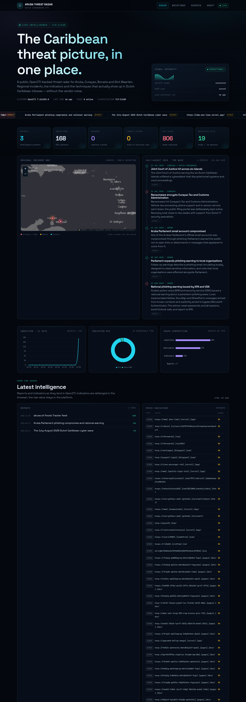

# Aruba Threat Radar

**A public threat-intelligence desk for Aruba and the Dutch Caribbean.**

OpenCTI + MISP running on Proxmox, a Python collector, and a static dashboard/blog that can be published anywhere. Built because there was no consistent, structured, public picture of the threats hitting Aruba, Curaçao, Bonaire and Sint Maarten.



<p align="center"><em>Live radar: regional incident map, OpenCTI counts, curated ATT&amp;CK coverage, defanged indicators and feed health.</em></p>


```
   MISP feeds ─┐
   ATT&CK ─────┤      ┌──────────┐      ┌───────────┐      ┌──────────────┐
   ATLAS ──────┼─────►│ OpenCTI  │─────►│ collector │─────►│ static site  │
   CISA KEV ───┤      │ (STIX)   │      │  (JSON)   │      │ radar + blog │
   datasets ───┘      └──────────┘      └───────────┘      └──────────────┘
                            ▲                                     │
                         MISP ◄── public OSINT feeds        Caddy / any host
```

## What it does

- **Ingests** public CTI: CIRCL OSINT, URLhaus, Feodo Tracker, Botvrij, OpenPhish through MISP; MITRE ATT&CK, MITRE ATLAS, CISA KEV and OpenCTI reference data through connectors.
- **Structures** it in OpenCTI as a STIX 2.1 graph — reports, indicators, malware, actors, campaigns, vulnerabilities, sectors and locations.
- **Publishes** a TLP:CLEAR snapshot: live counts, latest reports, defanged indicators, feed health, a curated regional incident map and an ATT&CK coverage view.
- **Explains** it in long-form briefings with sources on every claim.
- **Documents** the whole stack so another island (or another analyst) can copy it.

## Live deployment

| | |
|---|---|
| Public mirror (blog + radar snapshot) | `https://kevinflorencio.github.io/opencti-aruba/` |
| Radar / blog (LAN) | `http://192.168.0.180` |
| OpenCTI UI | `https://192.168.0.180:8443` |
| MISP | `https://192.168.0.180:9443` |
| Proxmox VM | `124` · `opencti-aruba` · 8 vCPU / 20 GB / 100 GB |
| OS | Debian 13 |
| OpenCTI | `7.261103.0` |

Credentials are generated at install time by `scripts/gen-env.sh` and `scripts/gen-misp-env.sh`, stored only in `.env` files with mode `600`. They are never committed.

## Repository layout

```
.
├── docker-compose.yml          OpenCTI, Elasticsearch, Redis, RabbitMQ, S3, connectors, Caddy
├── .env.example                every variable, no secrets
├── caddy/Caddyfile             static site + OpenCTI reverse proxy, internal TLS
├── misp/
│   ├── docker-compose.yml      MISP stack (pinned upstream compose + port/network changes)
│   └── .env.example
├── scripts/
│   ├── gen-env.sh              generate OpenCTI secrets
│   ├── gen-misp-env.sh         generate MISP secrets + TLS cert, wire API key
│   ├── collect_radar.py        OpenCTI GraphQL + MISP → public snapshot
│   ├── refresh.sh              collect → build site (cron/systemd entrypoint)
│   ├── backup.sh               volumes + MISP database
│   └── seed_aruba.py           Aruba/Caribbean entities, campaign and report
├── deploy/systemd/             collector timer + service
├── site/                       Astro dashboard + blog (static output)
├── docs/                       architecture, deployment, runbook, security, sources
└── .github/workflows/          optional Pages deployment
```

## Quick start

On a fresh Debian 13 host with Docker:

```bash
git clone https://github.com/KevinFlorencio/opencti-aruba.git
cd opencti-aruba
cp .env.example .env          # or run scripts/gen-env.sh to generate secrets
# edit .env: OPENCTI_BASE_URL, passwords, tokens
docker compose up -d

# MISP (optional but recommended)
cd misp
cp .env.example .env          # or run scripts/gen-misp-env.sh from the repo root
docker compose up -d
```

Wait for `opencti` to report healthy, then open the UI and log in with `OPENCTI_ADMIN_EMAIL` / `OPENCTI_ADMIN_PASSWORD`.

Build the site:

```bash
cd site
npm install
npm run build
```

Collect a snapshot and refresh:

```bash
set -a; . ./.env; set +a
OPENCTI_TOKEN="$OPENCTI_ADMIN_TOKEN" MISP_KEY="$MISP_API_KEY" \
  python3 scripts/collect_radar.py --pretty
```

## Documentation

| Document | Contents |
|---|---|
| [Architecture](docs/ARCHITECTURE.md) | Components, data flow, sizing, design decisions |
| [Deployment](docs/DEPLOYMENT.md) | Proxmox VM, cloud-init, Docker, MISP, DNS/TLS |
| [Runbook](docs/RUNBOOK.md) | Health checks, restarts, backups, upgrades, failure modes |
| [Security](docs/SECURITY.md) | Exposure model, tokens, TLP handling, hardening checklist |
| [Sources](docs/SOURCES.md) | Every feed, licence, cadence and how to add one |
| [Dashboard](docs/DASHBOARD.md) | Snapshot contract, collector behaviour, site build |
| [Publishing](docs/PUBLISHING.md) | LAN, real domain, GitHub Pages, Cloudflare |
| [MISP](docs/MISP.md) | First boot, API key, feeds, OpenCTI connector |

## Design principles

1. **Platform ≠ publication.** OpenCTI is never exposed publicly. A collector writes a field-limited JSON snapshot; the site renders it.
2. **TLP:CLEAR only.** Sensitive sources stay in the platform. The public contract is documented and enforced in code.
3. **Human regional layer.** Global feeds do not know Aruba. The incident map, ATT&CK view and briefings are curated from public reporting, with a source link on every entry.
4. **No invented attribution.** "Unknown" is a valid answer. Assessments are labelled.
5. **Reproducible.** Pinned images, generated secrets, documented upgrade path.

## Status

- [x] OpenCTI 7 on Proxmox with persistent volumes
- [x] MISP with public feeds (CIRCL, Botvrij, URLhaus, Feodo, OpenPhish, ET) and OpenCTI connector
- [x] MITRE ATT&CK, ATLAS, CISA KEV, reference datasets
- [x] Public radar (map, KPIs, reports, 280+ indicators, ATT&CK view, source health)
- [x] Blog with four sourced briefings, including the first weekly brief
- [x] Collector + refresh timer + backup script
- [x] MISP deployment notes for the healthcheck, session and auth traps
- [ ] OpenCTI analyst dashboards (in-platform)
- [ ] STIX/TAXII public export
- [ ] MISP galaxies/object templates so malware and actor context survives import
- [ ] Papiamento and Dutch brief summaries
- [ ] Anonymous community reporting form

## Licence

Code: MIT. Written content: CC BY 4.0. Feed data remains under the licence of its origin — see [docs/SOURCES.md](docs/SOURCES.md).

Built in Aruba by [Kevin Florencio](https://github.com/KevinFlorencio).
